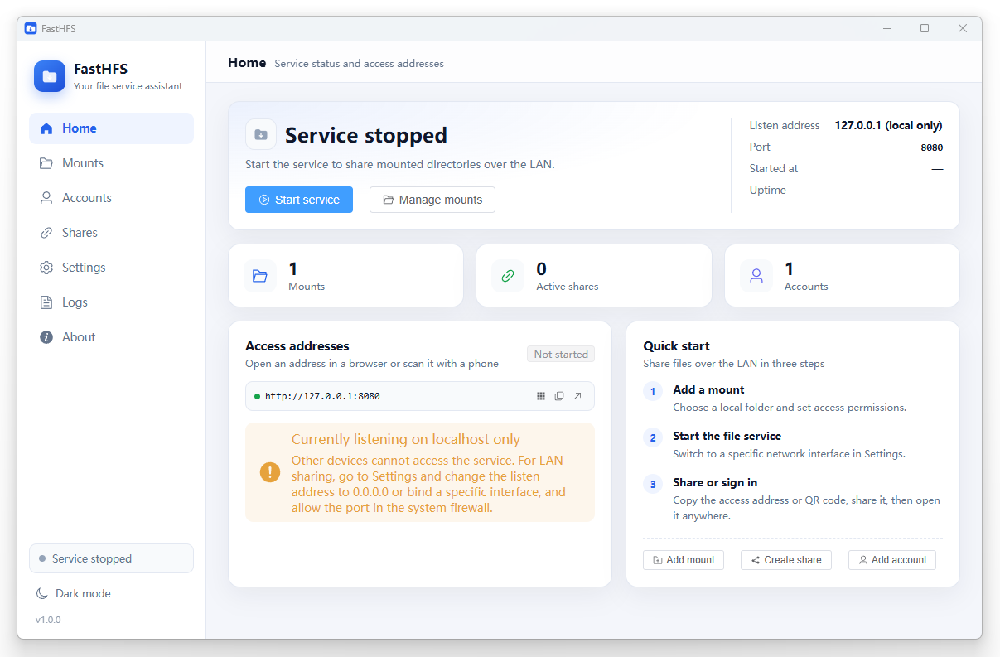

# FastHFS

English | [简体中文](README.md)

[FastHFS Website](https://gegecoder.github.io/FastHFS/)

FastHFS is a cross-platform HTTP file service tool. It supports mounting local directories, account sign-in, share links, uploads and downloads with bandwidth limits, and can keep running in the system tray, giving users a convenient way to serve files.

## Features

**File service**

- Browse directories, download files, and pack directories into ZIP archives
- Uploads with tus resumable chunks (interrupted large uploads can be resumed)
- Create directories, rename, delete, and preview files (images, text, audio, video, etc.)
- Download/upload bandwidth limits (KB/s), per-file size cap, upload extension blacklist
- Per-IP requests-per-minute limit, with a separate stricter limit on sign-in
- Support for running behind a reverse-proxy sub-path

**Mounts and permissions**

- Mount any local directory and expose it under an alias
- Toggle browse / download / upload / delete permissions individually
- Ignore rules to hide files by name or extension
- Anonymous access policies: `deny` (sign-in required) / `readonly` (read-only) / `upload` (uploads allowed)

**Share links**

- Three modes: `preview`, `download`, and `collect` (upload only)
- Optional access password (stored with bcrypt), expiry in hours, and maximum visit count
- The share page includes a QR code, and the QR image can be copied with a click
- A details view shows visit count, password status, expiry, creation time, and the full link

**Accounts and security**

- Accounts are used to sign in to the file service; passwords are stored as bcrypt hashes
- Sign-in issues a 7-day JWT (the signing secret is randomly generated and persisted in the database)
- Supports password reset and shows the last sign-in time
- The public API accepts both JWT and HTTP Basic Auth, which is convenient for scripts

**Desktop experience**

- Lives in the system tray: start/stop the service, open the panel, open or copy the access URL, and quit
- Closing the window hides it to the tray (the process keeps running on macOS)
- The listen address can bind to `127.0.0.1`, `0.0.0.0`, or a specific network interface
- Launch at login, light/dark themes, Chinese/English UI
- QR code for access URLs, one-click copy, and open in browser
- Built-in log viewer, open log directory, and Syslog forwarding
- Version update checks against GitCode releases

**Deployment**

- Desktop application (Windows / Linux / macOS)

## Tech stack

| Layer | Technology |
| --- | --- |
| Desktop framework | Wails v3  |
| Backend | Go 1.25, Gin, golang-jwt, bcrypt, modernc.org/sqlite (pure Go, no CGO) |
| Frontend (admin panel) | Vue 3, TypeScript, Vite, Element Plus, qrcode |
| Frontend (visitor site) | Vue 3, TypeScript, Vite |

## License

This project is released under the MIT License for learning and sharing. For commercial use or redistribution, please contact the author first.
