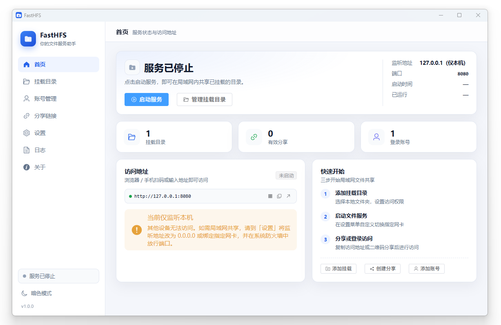

# FastHFS

[English](README.en.md) | 简体中文

[FastHFS 官网](https://gegecoder.github.io/FastHFS/) 

FastHFS 是一个跨平台的 HTTP 文件服务工具：支持挂载本地目录、账号登录、分享链接、上传下载与限速等能力，并可通过托盘常驻运行，为用户提供便捷的文件服务体验。

## 功能特性

**文件服务**

- 目录浏览、文件下载、目录打包为 ZIP
- 上传：支持 tus 分片续传（大文件中断后可恢复）
- 在线新建目录、重命名、删除、文件预览（图片/文本/音视频等）
- 下载/上传限速（KB/s），单文件大小上限，上传后缀黑名单
- 单 IP 每分钟请求数限制，登录接口独立限流
- 支持反向代理子路径

**挂载与权限**

- 挂载任意本地目录，设置对外别名
- 逐项开关浏览 / 下载 / 上传 / 删除权限
- 忽略规则（按名称/后缀过滤不希望暴露的文件）
- 匿名访问策略：`deny`（必须登录）/ `readonly`（只读）/ `upload`（可上传）

**分享链接**

- 三种模式：`preview` 预览、`download` 下载、`collect` 收集（仅上传）
- 可选访问密码（bcrypt 存储）、有效期（小时）、最大访问次数
- 分享页自带二维码，二维码图片可点击复制
- 分享详情集中展示次数、密码状态、有效期、创建时间与完整链接

**账号与安全**

- 账号用于登录文件服务，密码以 bcrypt 哈希存储
- 登录后签发 7 天有效 JWT（密钥随机生成并持久化在数据库中）
- 支持重置密码、查看最近登录时间
- 对外 API 同时接受 JWT 与 HTTP Basic Auth（便于脚本调用）

**桌面体验**

- 系统托盘常驻：启动/停止服务、打开面板、打开/复制访问地址、退出
- 关闭窗口即隐藏到托盘（macOS 不退出进程）
- 监听地址可绑定 `127.0.0.1`、`0.0.0.0` 或指定网卡
- 开机自启、浅色/深色主题、中文/英文界面
- 访问地址二维码、一键复制、一键在浏览器打开
- 内置日志查看、日志目录打开、Syslog 外发
- 基于 GitCode Release 的版本更新检测

**部署形态**

- 桌面应用（Windows / Linux / macOS）

## 技术栈

| 层 | 技术 |
| --- | --- |
| 桌面框架 | Wails v3  |
| 后端 | Go 1.25、Gin、golang-jwt、bcrypt、modernc.org/sqlite（纯 Go，无 CGO） |
| 前端（管理面板） | Vue 3、TypeScript、Vite、Element Plus、qrcode |
| 前端（访客站点） | Vue 3、TypeScript、Vite |

## 许可证

本项目使用 MIT 协议开源，仅供学习交流使用，如需商用或二次分发，请先联系作者。
